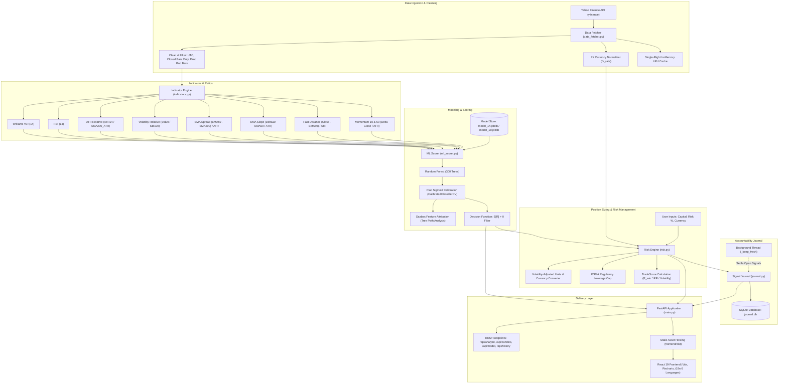
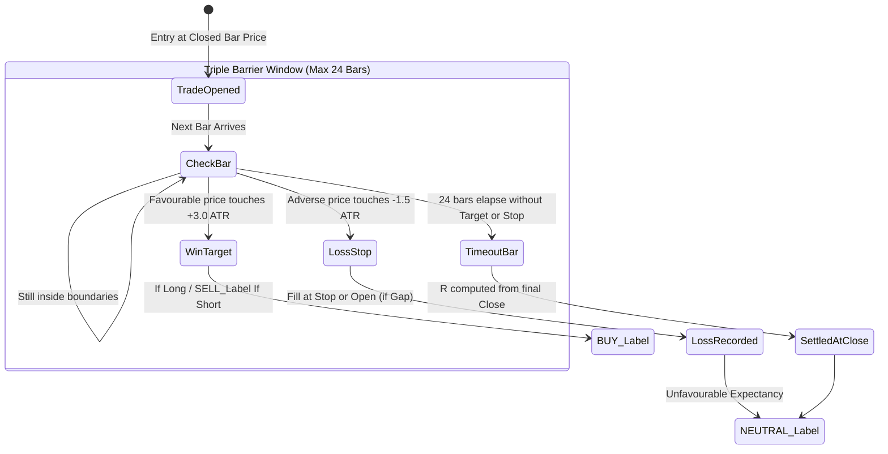
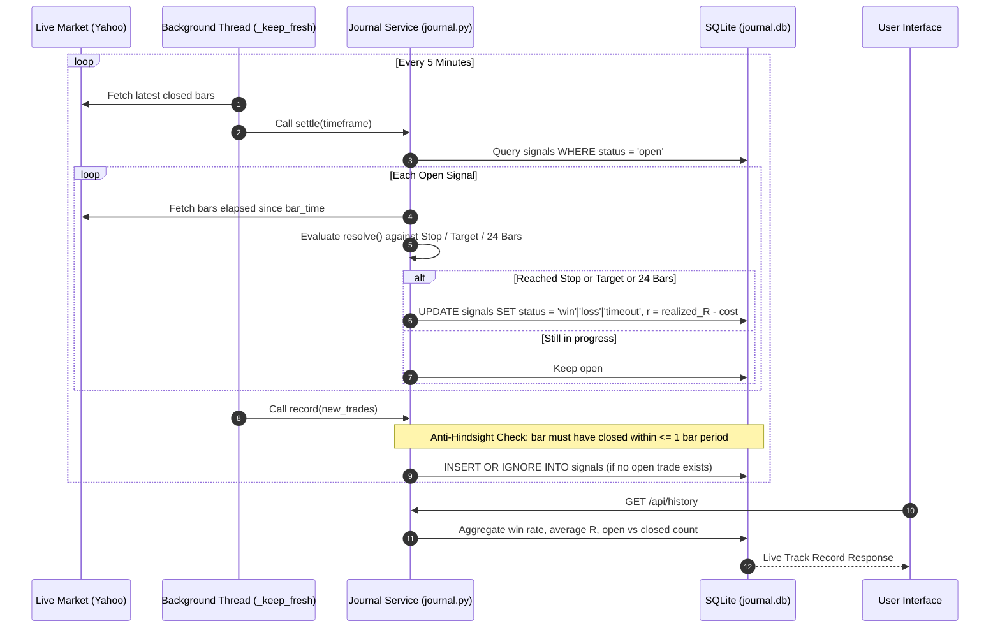

# ITDSS: Comprehensive Architecture, Mathematical Specification, and Operations Guide
**Intelligent Trading Decision Support System (Version 2.0.0)**

---

## 1. Executive Summary & Core Philosophy

The **Intelligent Trading Decision Support System (ITDSS)** is an explainable, risk-centric algorithmic market analysis platform. It processes financial market data across **37 instruments in 5 asset classes** (Forex, Cryptocurrencies, Equity Indices, Commodities, and Stocks) and accepts any arbitrary ticker available on Yahoo Finance.

> [!IMPORTANT]
> **Educational & Research System — Not Financial Advice:**
> ITDSS is designed strictly as a quantitative decision-support system. **It does not place trades or connect to broker execution endpoints.** In out-of-sample walk-forward testing against real historical data, the current technical indicator model demonstrates **no statistically proven edge** over a no-skill baseline (such as a majority-class predictor or passive buy-and-hold). The platform makes this limitation transparent on every interface and model report card.

### Key Tenets of the System Design
1. **Explainability Over Black-Box Predictions:** Every signal is accompanied by an exact attribution breakdown of feature drivers computed via tree-path decision analysis (Saabas algorithm).
2. **Strict Risk Geometry:** Every signal is defined by asymmetric triple-barrier risk parameters: a Stop Loss at \(-1.5 \times \text{ATR}\) and a Take Profit at \(+3.0 \times \text{ATR}\), enforcing a \(2:1\) Reward-to-Risk ratio with a hard 24-bar time horizon.
3. **Scale-Free Feature Space:** All engineered features are scale-invariant dimensionless ratios (normalized by ATR or relative percentage changes), allowing a single global machine learning model to score diverse assets ranging from Bitcoin ($60,000+) to EUR/USD ($1.08) without price-scale distortion.
4. **Accountability via Signal Journaling:** Live signals are logged into an append-only SQLite database upon issue and tracked continuously to determine their real out-of-sample financial outcomes.
5. **No Lookahead & No Repainting:** The pipeline strictly uses closed historical price bars, discarding the active, incomplete candle.

---

## 2. End-to-End System Architecture



---

## 3. Data Ingestion & Sanitization

The data engine is implemented in [`backend/services/data_fetcher.py`](file:///c:/Users/kunal/Downloads/itdss_deploy/itdss/backend/services/data_fetcher.py).

### 3.1 Strict Closed-Bar Filtration
Market indicators calculated on forming bars change dynamically before the bar closes ("repainting"), generating phantom signals that cannot be replicated in real trading. The `clean()` routine sanitizes all raw data:
- Timestamps are converted and localized to **UTC**.
- For any timeframe with duration \(M\) minutes, a bar timestamped at \(t_{\text{bar}}\) is considered closed if and only if:
  $$(t_{\text{bar}} + M\text{ minutes}) \le t_{\text{current}}$$
  Any still-forming bar is dropped immediately.
- Duplicate timestamps are purged, preserving the most recent record.
- Inconsistent price anomalies (where \(High < Low\) or any price \(\le 0\)) are eliminated, and High/Low are bound to the maximum and minimum of Open, High, and Close.

### 3.2 Single-Flight In-Memory Caching
To prevent hammering Yahoo Finance when multiple clients query simultaneously:
- A thread-safe LRU cache holds up to 400 entries with a key tuple of `(symbol, timeframe, period)`.
- **Time-to-Live (TTL):** 300 seconds (5 minutes) for `1h` bars; 1,800 seconds (30 minutes) for `1d` bars.
- If upstream network requests fail, the cache gracefully serves the last-known stale record rather than failing the entire request.

### 3.3 Multi-Currency Normalization
Because instruments are denominated in varying currencies (e.g., JPY, EUR, USD, INR, GBP), the `fx_rate(src, dst)` function dynamically obtains conversion rates:
- Automatically detects sub-currency quotations such as British Pence (`GBp` or `GBX`), South African Cents (`ZAc`), or Israeli Agora (`ILA`), scaling by \(0.01\).
- Evaluates direct or inverted currency pairs via Yahoo Finance (e.g., `USDJPY=X`) with a 1-hour cache.

---

## 4. Scale-Free Feature Engineering

Implemented in [`backend/services/indicators.py`](file:///c:/Users/kunal/Downloads/itdss_deploy/itdss/backend/services/indicators.py).

Standard raw technical indicators (such as raw price difference or unnormalized ATR) vary by orders of magnitude across instruments. ITDSS extracts **9 scale-free ratios**, ensuring that a single model operates consistently across any asset:

| Feature Name | Definition / Formula | Economic / Technical Meaning |
|---|---|---|
| `williams_r` | \(-100 \times \frac{\max_{14}(H) - C}{\max_{14}(H) - \min_{14}(L) + \epsilon}\) | Momentum oscillator capturing overbought/oversold levels relative to the 14-period range. |
| `rsi` | \(100 \times \frac{\text{EMA}_{14}(U)}{\text{EMA}_{14}(U) + \text{EMA}_{14}(D) + \epsilon}\) | Wilder-smoothed Relative Strength Index of upward vs downward price velocity. |
| `atr_rel` | \(\frac{\text{ATR}_{14}}{\text{SMA}_{200}(\text{ATR}_{14}) + \epsilon}\) | Volatility regime indicator: whether current volatility is elevated or subdued relative to normal. |
| `vol_rel` | \(\frac{\sigma_{20}(\text{returns})}{\sigma_{100}(\text{returns}) + \epsilon}\) | Short-term vs medium-term return volatility compression or expansion. |
| `ema_spread` | \(\frac{\text{EMA}_{50}(C) - \text{EMA}_{200}(C)}{\text{ATR}_{14} + \epsilon}\) | Trend strength and direction normalized into units of volatility (ATR). |
| `ema_slope` | \(\frac{\text{EMA}_{50}(C)_t - \text{EMA}_{50}(C)_{t-10}}{\text{ATR}_{14} + \epsilon}\) | Rate of change of the primary trend filter over a 10-bar window. |
| `dist_fast` | \(\frac{C - \text{EMA}_{50}(C)}{\text{ATR}_{14} + \epsilon}\) | Mean-reversion stretch: price distance from the fast moving average in ATR units. |
| `mom_10` | \(\frac{C_t - C_{t-10}}{\text{ATR}_{14} + \epsilon}\) | 10-bar normalized momentum. |
| `mom_50` | \(\frac{C_t - C_{t-50}}{\text{ATR}_{14} + \epsilon}\) | 50-bar normalized momentum. |

*Warm-up period:* The first 200 bars are discarded to allow the 200-period EMA and ATR to stabilize.

---

## 5. Machine Learning Pipeline & Statistical Validation

Implemented in [`backend/services/training.py`](file:///c:/Users/kunal/Downloads/itdss_deploy/itdss/backend/services/training.py) and [`backend/services/ml_scorer.py`](file:///c:/Users/kunal/Downloads/itdss_deploy/itdss/backend/services/ml_scorer.py).

### 5.1 The Triple Barrier Labeling Method
Traditional machine learning setups in finance often predict whether the next candle is green or red (\(P(C_{t+1} > C_t)\)). This is decoupled from realistic trading where stops and targets govern execution. ITDSS implements **Triple Barrier Labeling**:
- **Upper Barrier (Take Profit):** \(Entry + 3.0 \times \text{ATR}\) for Long (\(Entry - 3.0 \times \text{ATR}\) for Short).
- **Lower Barrier (Stop Loss):** \(Entry - 1.5 \times \text{ATR}\) for Long (\(Entry + 1.5 \times \text{ATR}\) for Short).
- **Vertical Barrier (Horizon Timeout):** \(24\) bars elapsed.



**Tie & Gap Resolution:**
- Within an individual bar, if both the stop and target boundaries are penetrated, **the stop loss takes precedence** (pessimistic assumption).
- If the market gaps past the stop on the bar open, the loss is recorded at the open price, capturing slippage beyond \(-1.0\,R\).
- Bars within 24 periods of the end of available history are assigned `NaN` labels to prevent lookahead bias.

### 5.2 Model Specification & Platt Probability Calibration
The model classifies market conditions into three discrete states:
$$\text{Class } 0 = \text{SELL}, \quad \text{Class } 1 = \text{NEUTRAL}, \quad \text{Class } 2 = \text{BUY}$$

- **Base Classifier:** Random Forest (`n_estimators=300`, `max_depth=8`, `min_samples_leaf=50`).
- **Calibration (`fit_calibrated`):** Raw Random Forest probability outputs are notorious for clustering around central values and failing to reflect true empirical frequencies. ITDSS uses **Platt Scaling** via `CalibratedClassifierCV(FrozenEstimator(rf), method="sigmoid")`:
  - 80% oldest training data trains the Random Forest.
  - 20% newest training data (purged to prevent label overlap) fits the sigmoid calibration mapping.

### 5.3 Purged Expanding Walk-Forward Evaluation
Evaluation is strictly out-of-sample over **5 expanding folds**:
1. Train set expands chronologically; test set moves forward.
2. An **embargo/purge window** equal to the 24-bar horizon is enforced prior to test boundaries to ensure zero future data leakage.
3. Six benchmark comparators are run side-by-side:
   - **Majority Class (Dummy):** Always predicts the prior class frequency.
   - **Logistic Regression:** Linear baseline with standard scaling.
   - **Decision Tree:** Single tree (`max_depth=6`).
   - **Histogram Gradient Boosting:** Modern boosting baseline.
   - **Rule-Only Baseline:** Classic technical strategy (Williams %R overbought/oversold with 50/200 EMA trend filter).
   - **Buy & Hold:** Equal-weighted asset class return.

### 5.4 Feature Explainability via Saabas Tree Decomposition
Rather than generic global importances, ITDSS calculates local instance-level feature attributions for every single scored bar using the Saabas tree-path algorithm:
- Traces the decision path of a bar across all 300 trees.
- Computes the delta in class probability from parent node to child node attributable to each feature split:
  $$\Delta P_f = \frac{1}{T} \sum_{t=1}^T \left( \frac{n_{\text{child, class}}}{n_{\text{child, total}}} - \frac{n_{\text{parent, class}}}{n_{\text{parent, total}}} \right)$$
- The resulting values are presented in the UI as the specific **Drivers** pushing the probability towards BUY or SELL.

---

## 6. Trade Decision, Sizing & Risk Management

Implemented in [`backend/services/risk.py`](file:///c:/Users/kunal/Downloads/itdss_deploy/itdss/backend/services/risk.py).

### 6.1 Expectancy-Based Decision Filter
A directional signal is **never** emitted simply because \(P(\text{BUY}) > P(\text{SELL})\). A trade is triggered if and only if its **expected return in R-multiples after round-trip transaction costs is positive**:

$$\mathbb{E}[R] = P_{\text{win}} \times RR + (1 - P_{\text{win}}) \times \bar{R}_{\text{nonwin}} - \text{Cost}_R > 0$$

Where:
- \(RR = \frac{3.0\,\text{ATR}}{1.5\,\text{ATR}} = 2.0\).
- \(\bar{R}_{\text{nonwin}}\) is the empirical average R-outcome of all trades that failed to reach the target (stops and timeouts) measured on historical data.
- \(\text{Cost}_R = \frac{\text{Cost}_{\text{asset}} \times \text{Entry}}{| \text{Entry} - \text{Stop} |}\), expressing round-trip spreads and fees as a fraction of the initial stop distance.
- If \(\mathbb{E}[R] \le 0\), the direction is assigned to **NEUTRAL**.

### 6.2 TradeScore Ranking Formula
When ranking potential trades across the entire 37-instrument universe, ITDSS applies:

$$\text{TradeScore} = \frac{P_{\text{win}} \times RR}{\text{atr\_rel}}$$

This prioritizes setups that have high win probability and high reward-to-risk, but penalizes instruments currently experiencing abnormal volatility spikes (\(\text{atr\_rel} > 1.0\)). Stale bars from closed markets are flagged and excluded from top recommendations.

### 6.3 Volatility & Confidence-Scaled Position Sizing
When personalizing a signal to the user's capital, risk percentage, and account currency:

1. **Risk Per Unit:**
   $$\text{Risk per Unit} = |\text{Entry} - \text{Stop}| \times \text{FX}_{\text{instrument} \to \text{account}}$$

2. **ML Confidence Multiplier:**
   $$M_{\text{size}} = \text{clip}\left(0.5 + 5 \times (P_{\text{win}} - P_{\text{breakeven}}),\, 0.5,\, 1.0\right)$$
   > [!NOTE]
   > \(M_{\text{size}}\) **never increases risk above the user's selected threshold** (maximum 1.0). If a trade has only marginal edge, it scales risk down toward 0.5.

3. **Position Size (Units):**
   $$\text{Units} = \frac{\text{Capital} \times \left(\frac{\text{Risk}\%}{100}\right) \times M_{\text{size}}}{\text{Risk per Unit}}$$

4. **ESMA-Modeled Regulatory Leverage Caps:**
   Positions are clamped so that gross notional leverage never exceeds institutional limits:
   $$\text{Max Leverage} = \{ \text{Forex}: 30\times,\, \text{Index}: 20\times,\, \text{Commodity}: 10\times,\, \text{Stock}: 5\times,\, \text{Crypto}: 2\times \}$$
   If \(\text{Units} \times \text{Entry} \times \text{FX} > \text{Capital} \times \text{Max Leverage}\), the position is capped and flagged as `capped = true`.

---

## 7. Signal Journal & Live Settlement Engine

Implemented in [`backend/services/journal.py`](file:///c:/Users/kunal/Downloads/itdss_deploy/itdss/backend/services/journal.py).



### Anti-Hindsight Guarantees
- A new trade is only admitted to the database if its triggering bar closed within the last single bar period (\(\le 1\,\text{bar}\) old). Stale signals from hours or days ago cannot be recorded retrospectively.
- Only one open trade is allowed per symbol and timeframe at any given time.

---

## 8. Frontend Interface & Internationalization

Implemented in [`frontend/src/`](file:///c:/Users/kunal/Downloads/itdss_deploy/itdss/frontend/src/).

### 8.1 Technology Stack
- **Framework:** React 19 with Vite.
- **Charts:** Recharts (responsive sparklines, calibration curves, and walk-forward equity simulations).
- **Icons:** Lucide React.
- **Styling:** Handcrafted high-performance CSS (`index.css`) supporting Dark Mode, Light Mode, and high-contrast color-blind accessibility palettes (using blue/amber instead of ambiguous red/green).

### 8.2 Six-Language Internationalization (i18n) with RTL
Built into [`frontend/src/i18n.js`](file:///c:/Users/kunal/Downloads/itdss_deploy/itdss/frontend/src/i18n.js):
- Supports **English (`en`)**, **Spanish (`es`)**, **Mandarin Chinese (`zh`)**, **Arabic (`ar`)**, **Hindi (`hi`)**, and **Portuguese (`pt`)**.
- When Arabic is activated, the application automatically dynamically toggles `document.documentElement.dir = 'rtl'` for complete right-to-left UI alignment.
- Culture-aware currency, date, and decimal formatters via native `Intl.NumberFormat` and `Intl.DateTimeFormat`.

---

## 9. Comprehensive API Endpoint Reference

| Endpoint | Method | Key Parameters | Description |
|---|---|---|---|
| `/api/health` | `GET` | — | System health status and availability of 1h and 1d model bundles. |
| `/api/symbols` | `GET` | — | Complete dictionary of asset universes, supported timeframes, and currencies. |
| `/api/analyze` | `GET` | `timeframe`, `asset`, `capital`, `risk`, `currency`, `top` | Returns scored universe, ranked top actionable trades, and driver explanations. |
| `/api/top-trades` | `GET` | `timeframe`, `capital`, `risk`, `currency`, `n` | Lightweight endpoint returning top \(N\) non-neutral actionable trades. |
| `/api/analyze/{symbol}` | `GET` | `symbol`, `timeframe`, `capital`, `risk`, `currency` | In-depth analysis and sizing for any specific ticker (including ad-hoc Yahoo tickers). |
| `/api/candles/{symbol}` | `GET` | `symbol`, `timeframe`, `n` | OHLC bar series with 50-period and 200-period EMA overlays for chart rendering. |
| `/api/search` | `GET` | `q` | Real-time ticker search query against the Yahoo Finance search API. |
| `/api/history` | `GET` | `timeframe`, `limit` | Live signal journal track record, win rates, and closed trade outcomes. |
| `/api/model` | `GET` | `timeframe` | Detailed model card, walk-forward benchmark comparisons, calibration points, and confusion matrix. |
| `/api/train` | `POST` | `timeframe`, Header: `X-Admin-Token` | Starts asynchronous background model retraining (admin protected). |
| `/api/train` | `GET` | — | Status of active training job and recent training console logs. |

---

## 10. Operational & Deployment Guide

### 10.1 Running Locally
#### Option A: Single Unified Server (Recommended)
FastAPI serves the compiled React application directly from `frontend/dist`:
```bash
# 1. Build the frontend
cd frontend
npm install
npm run build

# 2. Run the FastAPI backend from repository root
cd ..
python -m uvicorn main:app --app-dir backend --host 127.0.0.1 --port 8000
```
Open **[http://127.0.0.1:8000](http://127.0.0.1:8000)** in your browser.

#### Option B: Decoupled Development Mode
For live UI development with Hot Module Replacement (HMR):
```bash
# Terminal 1: Backend
python -m uvicorn main:app --app-dir backend --host 127.0.0.1 --port 8000

# Terminal 2: Frontend Vite Server
cd frontend
npm run dev
```
Open **[http://localhost:5173](http://localhost:5173)** (or port 5174 if 5173 is busy).

### 10.2 Production Environment Variables
| Variable | Default Value | Description |
|---|---|---|
| `ITDSS_ORIGINS` | `http://localhost:3000,http://localhost:5173` | Comma-separated list of allowed CORS origins. |
| `ITDSS_RATE_LIMIT`| `60` | Maximum allowed API requests per minute per IP address. |
| `ITDSS_ADMIN_TOKEN`| *(Empty)* | Secret token required to trigger `/api/train`. When empty, HTTP retraining is disabled. |
| `ITDSS_DATA_DIR` | `backend/data` | Filesystem path for `journal.db` SQLite database. |
| `ITDSS_BACKGROUND`| `1` | Set to `1` to run the 5-minute background cache and settlement worker. |

### 10.3 Retraining the Models
To execute a full expanding walk-forward re-evaluation and save updated calibrated bundles:
```bash
cd backend
python train.py
```
This evaluates all 5 folds across all 37 instruments, writes out-of-sample metrics into `ml/report_1h.json` and `ml/report_1d.json`, and updates `model_1h.joblib` and `model_1d.joblib` atomically.
